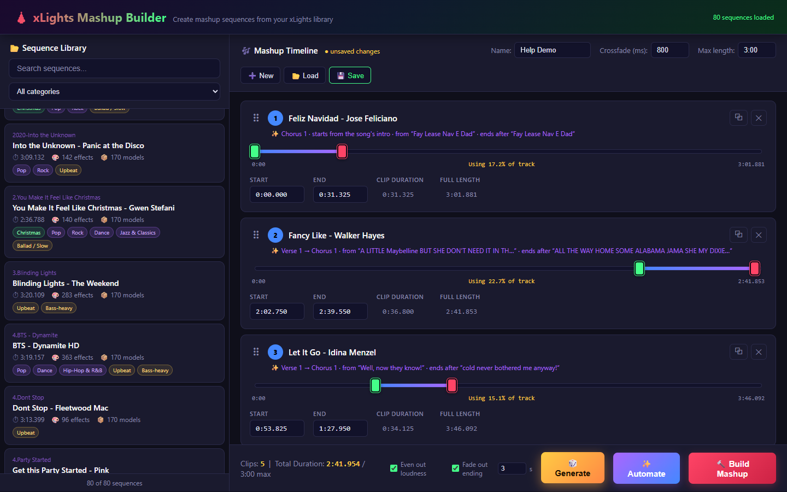

# xLights Mashup Builder

A local web app that builds **mashup sequences** from an existing [xLights](https://xlights.org) show. Pick songs you've already sequenced (or let the app pick them), choose which part of each to use, and it writes a new `.xsq` sequence plus a matching `.mp3` — with every lighting effect carried over and moved to the right time.



## Features

- **Timeline editing** — two-handle trim slider per clip, drag-to-reorder, drag songs in from the library, use a song more than once
- **✨ Automate** — listens to the songs and reads each sequence's lyric timing track to find the chorus and phrase endings; cuts land on bar lines and never mid-word; running order by best flow (tempo, key, energy), scrambled, or kept as-is
- **🎲 Generate** — classifies your library (themes from lyrics, genres from MusicBrainz, moods from the audio) and picks songs by category that work together; every generation is different, and it respects songs you add or remove
- **Transitions** — crossfade, fade out → fade in (you set the total; half fades the old song out, half fades the new one in — music and lights), or a straight cut
- **Build** — loudness levelling (−16 LUFS), Video effects re-timed instead of cut, a fade-out ending using xLights' Fade Out transition, one-click zip download
- **Save / load** mashup projects, maximum-length limit, built-in help page with screenshots

The app only **reads** your show — everything it creates goes to its own `output/` folder.

## Download and install (Windows)

### 1. Install Python (skip if you already have it)

1. Download **Python 3.12 or newer** from [python.org/downloads](https://www.python.org/downloads/).
2. Run the installer and **tick "Add python.exe to PATH"** on the first screen, then click **Install Now**.

### 2. Download the project as a zip

Download **[xlights-mashup-main.zip](https://github.com/shaun05-cell/xlights-mashup/archive/refs/heads/main.zip)** (about 1.3 MB).

Or, on the [project page](https://github.com/shaun05-cell/xlights-mashup), click the green **Code** button, then **Download ZIP**.

### 3. Extract the zip

1. Open your **Downloads** folder, right-click **xlights-mashup-main.zip** and choose **Extract All…**
2. Pick where to put it — for example your **Documents** folder — and click **Extract**.

You'll get a folder called **`xlights-mashup-main`** containing `app.py`, `install.py`, `requirements.txt` and the `core`, `static` and `templates` folders. You can rename the folder if you like.

> Windows lets you open a zip like a folder without extracting it — don't run anything from there. Always extract first.

### 4. Run the installer

1. Open the extracted **`xlights-mashup-main`** folder in File Explorer.
2. Click in the **address bar** at the top, type `cmd` and press **Enter**. A Command Prompt opens in that folder.
3. Type this and press **Enter**:

   ```bat
   python install.py
   ```

4. Wait for **✓ All set!** (the first time it downloads a few packages, which can take a minute).

The installer checks your Python version, sets up pip if it's missing, installs the packages listed in `requirements.txt`, and confirms everything works. `python install.py --check` just reports what's installed without changing anything.

**If you see "'python' is not recognized"**, use `py install.py` instead, or re-run the Python installer and tick **"Add python.exe to PATH"**.

### 5. Start the app

In the same Command Prompt:

```bat
python app.py
```

Your browser opens the app. Next time, open the folder, type `cmd` in the address bar again, and run `python app.py`.

### Updating to a new version

1. Download and extract the new zip as in steps 2–3 (into a new folder).
2. Copy these from your old folder into the new one, if they exist, to keep your settings and work:
   - `config.json` — your show and media folders
   - `saved_mashups` — your saved mashups
   - `library_overrides.json` — your category corrections
   - optional: `output`, `analysis_cache`, `library_cache` and `loudness_cache.json` — your built mashups and the library analysis (saves re-scanning)
3. Run `python install.py` in the new folder, then `python app.py`.

## Your show folders

The first time you run the app, it asks for two folders (with standard Windows folder pickers) and saves them in `config.json`:

- your **xLights show folder** — the one that contains `Sequences`
- your **media folder** — where your music and video files live (Cancel = same as the show folder)

It asks again if the saved show folder ever disappears (e.g. a drive letter changed). You can also create `config.json` yourself from `config.example.json`:

```json
{
  "show_dir": "C:\\path\\to\\your\\xLights\\show",
  "media_dir": "C:\\path\\to\\your\\media"
}
```

`config.json` is ignored by git, so your paths stay on your machine. (Environment variables `XLMASHUP_SHOW_DIR` / `XLMASHUP_MEDIA_DIR` override it.)

ffmpeg is bundled through `imageio-ffmpeg`; nothing else to install.

## Run

```bash
python app.py               # opens http://localhost:5000 in your browser
python app.py --no-browser  # start without opening a browser
```

Click **❓ Help** in the app for a full illustrated guide.

## Using a mashup in xLights

1. Build, then click **📦 Download all (.zip)** and unzip the folder into your show's `Sequences` folder
2. Open the `.xsq` in xLights (point it at the `.mp3` in the same folder if asked)
3. Render All (Ctrl+Shift+R) and add it to your playlist

## Online services

Optional, no API keys needed: [LRCLIB](https://lrclib.net) for synced lyrics when a sequence has no lyric track, and [MusicBrainz](https://musicbrainz.org) for genre tags (rate-limited to one request per second). Everything else works offline.

## Documentation

- In-app guide: `/help` (source: `templates/help.html`)
- Technical design, file formats and algorithms: [ARCHITECTURE.md](ARCHITECTURE.md)
