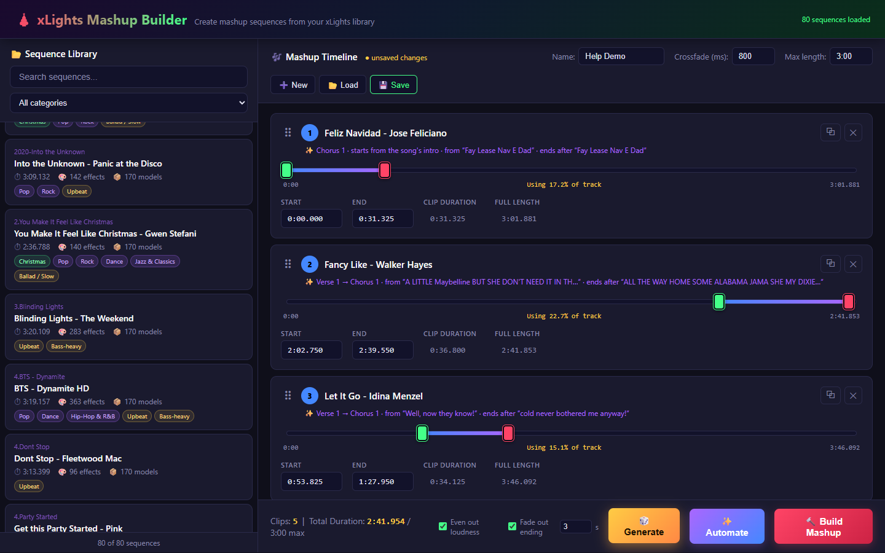

# xLights Mashup Builder

A local web app that builds **mashup sequences** from an existing [xLights](https://xlights.org) show. Pick songs you've already sequenced (or let the app pick them), choose which part of each to use, and it writes a new `.xsq` sequence plus a matching `.mp3` — with every lighting effect carried over and moved to the right time.



## Features

- **Timeline editing** — two-handle trim slider per clip, drag-to-reorder, drag songs in from the library, use a song more than once
- **✨ Automate** — listens to the songs and reads each sequence's lyric timing track to find the chorus and phrase endings; cuts land on bar lines and never mid-word; running order by best flow (tempo, key, energy), scrambled, or kept as-is
- **🎲 Generate** — classifies your library (themes from lyrics, genres from MusicBrainz, moods from the audio) and picks songs by category that work together; every generation is different, and it respects songs you add or remove
- **Build** — loudness levelling (−16 LUFS), Video effects re-timed instead of cut, crossfades, a fade-out ending using xLights' Fade Out transition, one-click zip download
- **Save / load** mashup projects, maximum-length limit, built-in help page with screenshots

The app only **reads** your show — everything it creates goes to its own `output/` folder.

## Setup

Requires Python 3.12+ (developed on 3.15) on Windows.

```bash
pip install -r requirements.txt
```

The first time you run it, the app asks for two folders (with standard Windows folder pickers) and saves them in `config.json`:

- your **xLights show folder** — the one that contains `Sequences`
- your **media folder** — where your music and video files live (Cancel = same as the show folder)

It asks again if the saved show folder ever disappears (e.g. a drive letter changed). You can also create `config.json` yourself from `config.example.json`:

```json
{
  "show_dir": "C:\\path\\to\\your\\xLights\\show",
  "media_dir": "C:\\path\\to\\your\\media"
}
```

`config.json` is ignored by git, so your paths stay on your machine. (Environment variables `XLMASHUP_SHOW_DIR` / `XLMASHUP_MEDIA_DIR` override it.)

ffmpeg is bundled through `imageio-ffmpeg`; nothing else to install.

## Run

```bash
python app.py               # opens http://localhost:5000 in your browser
python app.py --no-browser  # start without opening a browser
```

Click **❓ Help** in the app for a full illustrated guide.

## Using a mashup in xLights

1. Build, then click **📦 Download all (.zip)** and unzip the folder into your show's `Sequences` folder
2. Open the `.xsq` in xLights (point it at the `.mp3` in the same folder if asked)
3. Render All (Ctrl+Shift+R) and add it to your playlist

## Online services

Optional, no API keys needed: [LRCLIB](https://lrclib.net) for synced lyrics when a sequence has no lyric track, and [MusicBrainz](https://musicbrainz.org) for genre tags (rate-limited to one request per second). Everything else works offline.

## Documentation

- In-app guide: `/help` (source: `templates/help.html`)
- Technical design, file formats and algorithms: [ARCHITECTURE.md](ARCHITECTURE.md)
